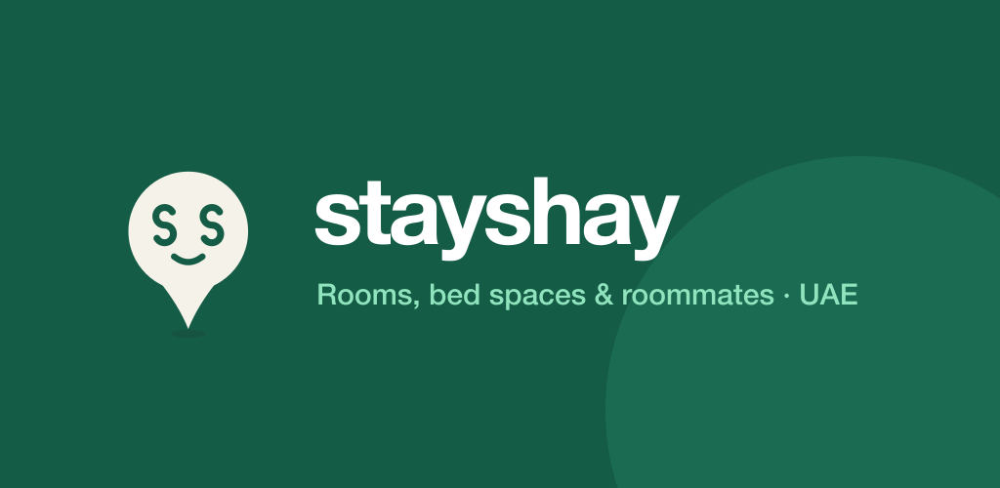

# Stayshay — launch the app on the App Store and Google Play

<p align="center">
  
  &nbsp;&nbsp;
  
</p>

One codebase (Expo / React Native) gives you the iPhone and Android apps. Listings come from the website’s
`/api/listings` feed, so anything the team publishes in **/admin** shows up in the app within a minute.

| What | Where |
| --- | --- |
| App code | `apps/mobile` (Expo SDK 58, expo-router) |
| Shared logic (search, prices, forms) | `packages/core` |
| App icons, splash | `apps/mobile/assets` (regenerate: `npm run mobile:icons`) |
| Store graphics | `apps/mobile/store` |
| Build config | `apps/mobile/app.json`, `apps/mobile/eas.json` |
| Bundle ID (both stores) | `ae.stayshay.app` |

---

## Step 0 — before anyone outside the team sees it

- [ ] **Replace the test listings.** The current catalogue is homebook.ae data used with permission for private testing.
      A store app is public, so publish your own listings from **/admin** and stop importing homebook data
      (`rm packages/core/src/data/homebook.json && rm -rf apps/web/public/hb`, then rebuild the site).
- [ ] **Put the website online** at a public HTTPS address (Step 2). The app cannot reach `192.168.x.x` from outside your Wi-Fi.
- [ ] Set a strong `ADMIN_PASSWORD` on the server.
- [ ] Check the WhatsApp number in `packages/core/src/brand.ts` (now **+971 56 904 8493**).

---

## Step 1 — try it on your own phone (5 minutes, free)

1. Install **Expo Go** from the App Store / Google Play.
2. On the Mac, start the website and the app (two terminals):

   ```bash
   cd ~/Projects/startups/stayshay
   npm run build && cd apps/web && npx next start -p 3210 -H 0.0.0.0   # terminal 1
   cd ~/Projects/startups/stayshay/apps/mobile && npx expo start           # terminal 2
   ```
3. Scan the QR code: iPhone with the Camera app, Android inside Expo Go. Phone and Mac must be on the same Wi-Fi.
   The app reads listings from `http://192.168.1.137:3210` (`extra.apiUrl` in `app.json`). If your Mac’s IP changes, update it there.

**Friends on other networks:** run `npx expo start --tunnel` and give the website a temporary public URL
(for example `cloudflared tunnel --url http://localhost:3210`), then start Expo with
`EXPO_PUBLIC_API_URL=https://<that-url> npx expo start --tunnel`.

---

## Step 2 — put the website online

The app needs a permanent HTTPS address for `/api/listings`. Admin listings are saved as files in `STAYSHAY_DATA_DIR`,
so pick a host with a **persistent disk** (Railway, Render, Fly.io, or a small VPS). Vercel works for the pages but its
disk resets, so admin listings would need a database first (Supabase is the planned upgrade).

Server settings:

```
ADMIN_PASSWORD=<long random password>
STAYSHAY_DATA_DIR=/data            # the persistent volume
PUBLIC_BASE_URL=https://stayshay.ae
```

Then put that address in `apps/mobile/eas.json` (replace both `https://REPLACE-WITH-YOUR-PUBLIC-SITE`).

---

## Step 3 — accounts (one time)

| Account | Cost | Link |
| --- | --- | --- |
| Expo (builds in the cloud, no Xcode needed) | Free tier | https://expo.dev/signup |
| Apple Developer Program | USD 99 / year | https://developer.apple.com/programs/enroll/ |
| Google Play Console | USD 25 once | https://play.google.com/console/signup |

Apple enrolment as a company needs a D-U-N-S number and can take a few days. Start it today.

---

## Step 4 — build the apps (in Expo’s cloud)

```bash
npm install -g eas-cli
cd ~/Projects/startups/stayshay/apps/mobile
eas login
eas init                      # links the project, adds projectId to app.json
```

**Share with friends first (no store review):**

```bash
eas build --platform android --profile preview   # gives an .apk link anyone can install
eas build --platform ios --profile preview       # iPhones must be registered first: eas device:create
```

**Store builds:**

```bash
eas build --platform all --profile production
```

EAS creates and stores the iOS certificates and the Android signing key for you. Say **yes** when asked.

---

## Step 5 — store listings

### App Store Connect (https://appstoreconnect.apple.com → My Apps → +)
- Name **Stayshay** · Bundle ID **ae.stayshay.app** · SKU `stayshay-ios` · Primary language English
- Copy the app’s **Apple ID** (a number) into `eas.json → submit.production.ios.ascAppId`
- Category: **Lifestyle** (secondary: Travel) · Age rating: 4+
- Privacy policy URL: `https://<your-site>/privacy` · Support URL: `https://<your-site>/about`
- App Privacy: *Contact info (name, phone)*, used for *App functionality*, not linked to tracking
- Screenshots: 6.9" iPhone (1320×2868). Take them on a large iPhone (Side + Volume Up) from Explore, Search, a listing, Roommates and List

### Google Play Console (https://play.google.com/console → Create app)
- App name **Stayshay** · Free · App
- Icon: `apps/mobile/store/play-store-icon-512.png` · Feature graphic: `apps/mobile/store/feature-graphic-1024x500.png`
- Category: **House & Home** · Content rating questionnaire: no restricted content
- Data safety: collects *name* and *phone number*, for *app functionality*, not shared, encrypted in transit
- Phone screenshots: at least 2 (1080×1920 or larger)

### Store text (paste as is)

**Subtitle / short description (≤ 30 / 80 chars)**
> Rooms & roommates in the UAE
> Bed spaces, partitions, rooms and studios with real monthly prices. Ask on WhatsApp.

**Description**
> Stayshay helps you find an affordable place to live in the UAE, without the guesswork.
>
> • Bed spaces, partitions, private rooms and studios across Dubai, Sharjah, Abu Dhabi and Ajman
> • Real monthly rent, deposit, upfront cost and bills on every listing
> • Search by area or metro, filter by budget, bills included, no deposit and who can live there
> • Request a viewing in one tap: your name, move-in date and budget go straight to WhatsApp
> • Find a roommate who fits your budget and routine
> • Owners: list your place for free and get inquiries that already know your price
>
> Free for renters. Never pay before you’ve viewed a place.

**Keywords (iOS, 100 chars)**
> bed space,partition,room,rent,dubai,sharjah,roommate,flatmate,studio,monthly,sharing,uae

---

## Step 6 — submit

```bash
eas submit --platform ios --latest       # uploads to App Store Connect → TestFlight → Submit for review
eas submit --platform android --latest   # first upload: do it once by hand in Play Console (Internal testing), then this works
```

Apple review usually takes 1–3 days; Google 1–7 days for a new account. Google requires new personal accounts to run a
**closed test with 12 testers for 14 days** before production. Your friends are the testers: add their Gmail addresses
under *Testing → Closed testing*.

---

## Updating the app later

- Text, layout, screens (JavaScript only): `eas update --branch production` (live in minutes, no review)
- New icon, new native module, version bump: `eas build` + `eas submit` again
- Listings: nothing to do in the app. Publish in **/admin** on the website.

## Troubleshooting

| Symptom | Fix |
| --- | --- |
| “Can’t reach Stayshay” in the app | The website isn’t running or `EXPO_PUBLIC_API_URL` / `extra.apiUrl` points to the wrong address |
| Photos missing in the app | `PUBLIC_BASE_URL` not set on the server, so photo links point to an internal address |
| Expo Go says the SDK is unsupported | Update Expo Go from the store (the app uses SDK 58) |
| Apple rejects “minimum functionality” | Make sure real listings are live; the app must show content at review time |
